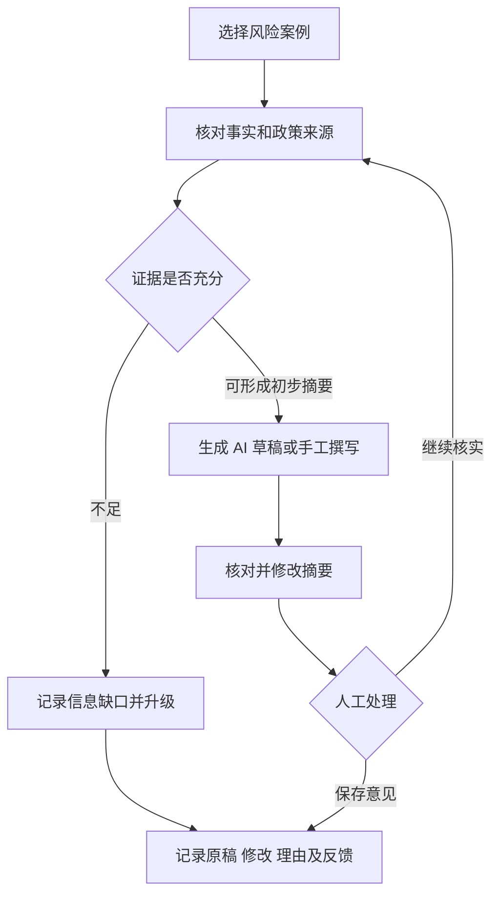

# GenAI 风险审核与调查辅助工作台 PRD

版本：v0.2 · 类型：个人项目 / 公开模拟数据 PoC。

本文以仓库实际实现为依据。用户痛点与收益目前属于待验证假设；没有企业上线、真实银行调查或用户访谈成果。产品范围仅覆盖本 GenAI 项目，不将独立 OOP 项目的功能视为已集成。

## 1. 场景与目标

在有限人工审核容量下，审核员需要查看高优先级交易、核对风险规则与政策依据、整理摘要，并记录处理意见。假设目前的困难是证据分散、摘要重复整理和记录不一致，需要通过用户研究验证。

产品目标：缩短形成合格审核摘要的过程，同时保留证据、信息缺口和人工判断。风险分数用于排序，不是欺诈定罪；LLM 不拥有最终决策权。

## 2. 目标用户与任务

| 用户假设 | 核心任务 | 对应设计 |
| --- | --- | --- |
| 一线审核员 | 查看风险交易并核对依据 | 案件列表、交易事实、规则与政策来源 |
| 复核人员 | 形成和确认有依据的处理意见 | AI 原稿、人工修改稿、审核理由与事件记录 |
| 项目维护者 | 发现错误、验证改动 | 反馈类别、评测脚本、提示词与模型运行信息 |

个人项目中的 reviewer name 是演示标识，不是经过认证的用户身份。真实部署需要身份认证、授权、数据治理和部署评审。

## 3. 范围与优先级

优先保障证据可查、摘要可修改、处理可追溯，再考虑多轮 Agent 和其他行业适配。继续使用现有模型、TF-IDF/规则政策关联、Pydantic 和 Streamlit，不新增模型训练任务。

| ID | 优先级 | 功能与实现位置 | 状态 |
| --- | --- | --- | --- |
| P01 | P0 | 固定容量风险排序与时间验证，`src/modeling.py` | 已有；本轮沿用已提交实验产物 |
| P02 | P0 | 案件、交易事实、规则与政策证据，`app.py` | 已有 |
| P03 | P0 | 冻结案例演示，`src/workspace.py` / `app.py` | 本轮补充；无需原始数据或模型包 |
| P04 | P0 | 生成摘要及确定性一致性校验，`src/llm.py` / `src/workspace.py` | 本轮完善；语义事实仍需人工核对 |
| P05 | P0 | 原稿、人工修改、理由、反馈与日志，`src/audit_store.py` / `app.py` | 本轮补充 |
| P06 | P0 | 真实/Mock 分离、失败数、延迟、token、可配置费用，`src/evaluation.py` | 本轮完善；真实端点尚待配置运行 |
| P07 | P1 | 操作手册、用户任务与迭代方法 | 本轮补充；用户试用尚未开展 |
| P08 | P2 | 多 Agent、制造业场景与企业系统接入 | 后续候选，不属于本次交付 |

## 4. 使用流程

案件状态沿用 NEW、REVIEWING、ESCALATED、CLOSED_NO_FRAUD、CLOSED_CONFIRMED。现阶段允许人工更正状态，记录前后状态；未实现基于角色的状态迁移审批。升级或结案需要理由。并发修改检测发现记录已变化时拒绝覆盖，用户需重新加载并复核。

## 5. 功能验收

| ID | 可观察的验收标准 | 证据 |
| --- | --- | --- |
| P01 | 时间测试与容量结果有来源，阈值口径和 Top-K 口径分别说明 | 现有 `docs/EXPERIMENT_REPORT.md` 与模型指标文件；本轮未重训练 |
| P02 | 查看原始字段、命中规则与政策 ID；普通模式不展示离线标签或 FN 筛选 | 界面、应用测试 |
| P03 | 克隆后安装依赖即可打开冻结案例；明确提示分层样本不代表全量队列 | 应用测试 |
| P04 | ID、风险标签、动作、来源路径和政策 ID 不符合确定性控制时拒绝草稿；校验通过也不宣称语义真实 | 控制校验测试 |
| P05 | 修改稿与生成原稿分别保存；保留操作者、理由、反馈、前后状态、数据和模型版本；旧数据库可迁移 | SQLite、迁移与并发测试 |
| P06 | 每次调用记录成功/失败、模型、用量和延迟；缺少价格或用量时费用为 unknown；新运行默认不覆盖历史基准 | 评测测试和运行 manifest |
| P07 | 新用户能按手册完成一个案例并提交反馈 | 手册已提供；真实代理用户试用待执行 |

## 6. AI 与数据边界

- 确定性程序计算数值、风险等级、推荐动作；LLM 将已提供证据组织为摘要。
- gold 与 metadata 不进入提示词或 provider 输入；离线欺诈标签仅用于评估。
- schema、引用 ID、来源路径和数字检查不等同于事实蕴含；反向表述、因果夸大和遗漏需要人工检查。
- PaySim 是模拟数据。政策文档明确为演示规则，不是银行制度或法律意见。
- 冻结案例来自 TP/FP/FN/TN 分层抽样，不用于估计队列流量、实际误报率或用户效益。
- 演示与完整评分队列分别使用本地数据库，避免相同 case ID 的记录混用。
- SQLite 写入流程追加事件；具备文件访问权的人仍可改数据库，不能称为防篡改账本。

## 7. 指标与验证计划

| 层级 | 指标 | 现阶段状态 |
| --- | --- | --- |
| 排序 | PR-AUC、Precision@K、Recall@K、告警量 | 已有模拟数据实验结果，本轮保持不变 |
| 生成 | JSON/schema 有效率、ID/标签/动作一致性、来源路径、政策引用、数字代理、覆盖率 | Mock 验证可运行；真实模型待运行 |
| 运行 | 调用成功率、延迟、token、显式价格下的估算成本 | 已提供记录能力；真实运行指标待采集 |
| 使用 | 合格摘要任务耗时、质量、重大修改率、任务完成率 | 尚未开展用户试用 |
| 推广 | 指南可理解性、首次任务完成情况、后续继续使用意愿 | 尚未测量，不声称已提高内部使用率 |

PoC 验收目标与实测结果必须分列。初始目标可设为冻结测试集中至少 29/30 结构有效、每个关键数字可溯源；样本有限，不推断企业可靠性。真实模型评测先做 5 例 smoke，再固定 60 例和模型版本比较四种提示词；按使用目的另建开发集，避免反复调整冻结测试集。

## 8. 用户研究与运营

使用 `docs/USER_VALIDATION.md` 的招募与任务方案，先邀请 3–5 位相关方向同学作为代理用户。有从业者参与时单独记录身份背景，不混同真实目标用户与代理用户。采用不同但难度相近的案例和交叉顺序，比较人工整理与 AI 辅助；同时记录质量，避免仅用速度评价。

推广材料包括 `docs/QUICKSTART.md`、一次完整任务演示、常见问题。当前交付了材料与测试，不声称完成企业内部推广。

## 9. 迭代与交付边界

本轮完成产品文档、演示入口、审核反馈与评测记录；下一轮依据真实模型失败案例调整；再依据实际用户反馈选择迭代。详见 `docs/PRODUCT_CHANGELOG.md`。个人独立开发不写成主导跨团队交付，准备访谈表不写成完成访谈。
